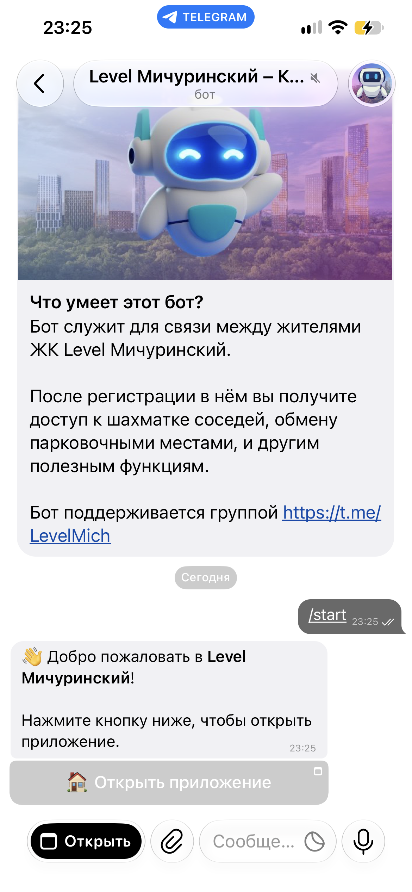
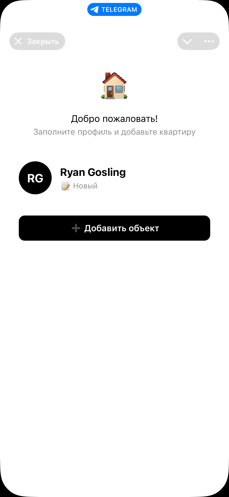
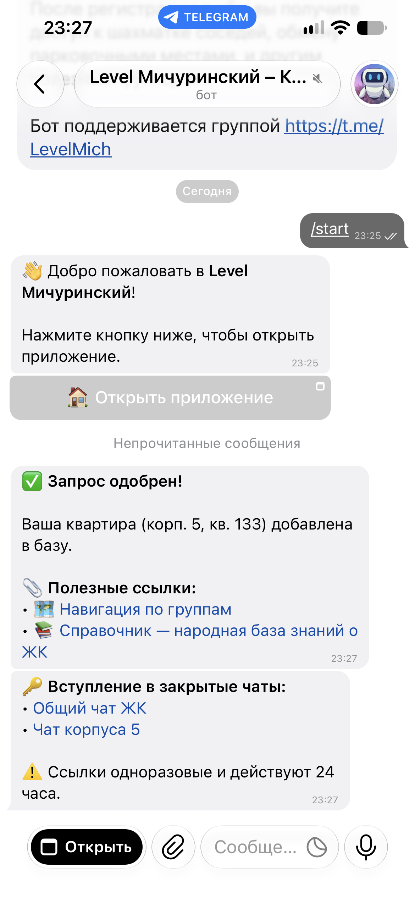
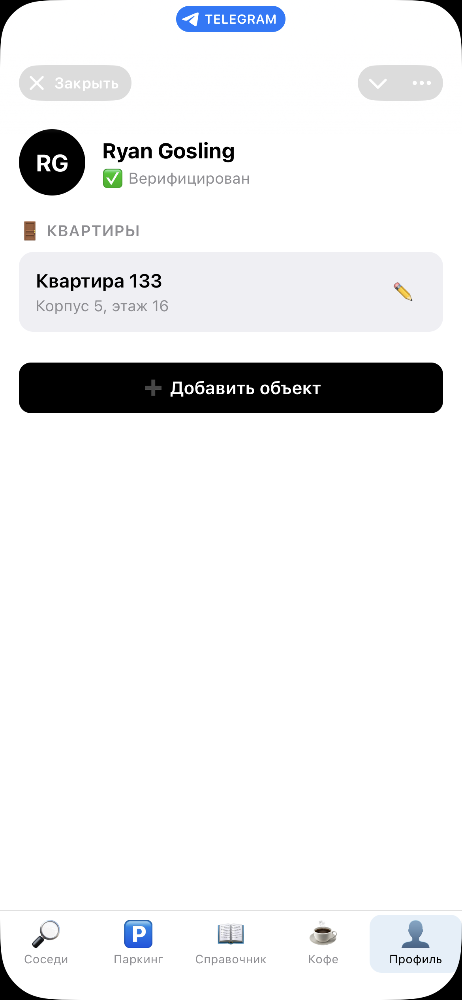

# Level Мичуринский — инструкция для жителей

Это руководство описывает, как пользоваться приложением: регистрация, личные данные, добавление квартиры/парковки/кладовки, парковочные запросы (с обеих сторон), справочник, поиск соседей и Random Coffee.

Текст актуализирован для обновлённого интерфейса. Некоторые скриншоты показывают прежнее оформление; ориентируйтесь на названия и действия в тексте.

---

## Содержание

1. [Начало работы](#1-начало-работы)
2. [Личные данные](#2-личные-данные)
   - [Добавление автомобиля](#добавление-автомобиля)
3. [Добавление объектов: квартира, парковка, кладовка](#3-добавление-объектов-квартира-парковка-кладовка)
   - [Квартира](#квартира)
   - [Парковка](#парковка)
   - [Кладовка](#кладовка)
4. [Парковка: я ищу место](#4-парковка-я-ищу-место)
   - [Создание запроса](#создание-запроса)
   - [Что происходит дальше](#что-происходит-дальше)
5. [Парковка: я делюсь своим местом](#5-парковка-я-делюсь-своим-местом)
   - [Шаг 1 — включить шеринг](#шаг-1-включить-шеринг)
   - [Шаг 2 (необязательно) — расписание и блокировки](#шаг-2-необязательно-расписание-и-блокировки)
   - [Шаг 3 — обработка входящих запросов](#шаг-3-обработка-входящих-запросов)
6. [Справочник](#6-справочник)
7. [Поиск соседей](#7-поиск-соседей)
   - [Как это работает](#как-это-работает)
   - [Карточка найденного человека](#карточка-найденного-человека)
   - [Шахматка](#шахматка)
   - [Дополнительный способ найти человека](#дополнительный-способ-найти-человека)
8. [Кофе (Random Coffee)](#8-кофе-random-coffee)
   - [Профиль](#профиль)
   - [Как проходит подбор](#как-проходит-подбор)
   - [Приглашения](#приглашения)
   - [Встречи](#встречи)

---

## 1. Начало работы

1. Откройте бота в Telegram и нажмите **/start** (или кнопку «Открыть приложение», если она уже есть в чате).

   

2. При первом запуске приложение сразу попросит заполнить профиль и добавить квартиру — экран «Добро пожаловать! Заполните профиль и добавьте квартиру».

   

3. Заполните имя, при желании — телефон (см. [раздел 2](#2-личные-данные)), и добавьте квартиру через кнопку «➕ Добавить объект» (подробности — [раздел 3](#3-добавление-объектов-квартира-парковка-кладовка)).

4. После отправки заявка уходит администраторам ЖК на модерацию. Пока заявка не одобрена, статус в приложении — «⏳ Ожидает подтверждения», доступ к остальным разделам ограничен.

5. Как только администратор одобрит заявку, вы получите от бота:
   - сообщение с полезными ссылками (если они настроены для вашего корпуса);
   - отдельное сообщение с **одноразовыми пригласительными ссылками** в общий закрытый чат ЖК и в чат вашего корпуса — по ним вы сразу попадёте в чаты, без ожидания одобрения администратором. Ссылки одноразовые и действуют 24 часа, так что стоит перейти по ним сразу.

   

6. После одобрения в приложении открываются все пять разделов нижнего меню: **Соседи**, **Паркинг**, **Справочник**, **Кофе**, **Профиль**.

   

---

## 2. Личные данные

На вкладке **Профиль** нажмите на своё имя или аватар, чтобы открыть настройки.

- **Имя** — обязательное поле.
- **Телефон** — 10 цифр после фиксированного «+7», первая цифра — «9».
- **Скрыть телефон от соседей** и **Скрыть Telegram Username** — настройки приватности. Скрытые данные остаются доступны администраторам.
- **Автомобили** — номера для поиска соседями и быстрого заполнения парковочного запроса.

Изменения подтверждаются кнопкой с галочкой **«Сохранить»** вверху шторки.

### Добавление автомобиля

1. Откройте настройки профиля и найдите блок «Автомобили».
2. Введите номер и нажмите «+» или Enter. Буквы переводятся в верхний регистр.
3. Можно добавить до 10 номеров. Для удаления нажмите действие рядом с номером и подтвердите удаление.
4. Сохраните профиль: добавление или удаление номера в форме само по себе не сохраняет изменения.

Скрытие телефона или username не запрещает соседям попросить Вас связаться через бота. Ваши скрытые данные при этом не раскрываются отправителю.

---

## 3. Добавление объектов: квартира, парковка, кладовка

На вкладке **Профиль** нажмите **«Добавить объект»**. Первый объект должен быть квартирой; после одобрения квартиры доступны также парковка и кладовка.

### Квартира

Укажите корпус, этаж, номер квартиры и тип связи: собственность, аренда или член семьи. Заявка проходит модерацию; до одобрения отображается статус ожидания.

### Парковка

Укажите очередь, этаж, номер места и тип владения. Для очередей 3 и 4 используется единственный этаж −1. Место добавляется без модерации и первоначально не участвует в шеринге.

### Кладовка

Укажите очередь, этаж, номер кладовки и тип владения. Кладовка добавляется без модерации.

Для изменения объекта нажмите его карточку в профиле. Сохранение — галочка вверху шторки; удаление требует подтверждения. Новые места регистрируются здесь, а не в разделе «Мои места» паркинга.

---

## 4. Парковка: я ищу место

При открытии раздела **Паркинг** отображается вкладка **Найти** с актуальными запросами. Владелец парковочного места видит также вкладки «Поделиться» и «Мои места».

### Создание запроса

1. Нажмите **«Новый запрос»** над нижней навигацией.
2. Выберите одну или несколько очередей.
3. Укажите марку и номер автомобиля. Подсказки марок берутся из последних запросов, номера — из автомобилей в профиле. Это независимые списки, а не сохранённые пары.
4. Укажите начало и окончание: начало должно быть в будущем, окончание — позже начала. Время — московское.
5. Отправьте запрос.

Марка и номер сохраняются в самом запросе. Эти данные видны автору во всех статусах, включая архив; последующие изменения профиля их не заменяют.

### Что происходит дальше

Запрос получают владельцы подходящих мест в выбранных очередях с включённым шерингом.

| Статус | Значение |
|---|---|
| Открыт | Место ещё не назначено |
| Согласован | Владелец принял запрос; назначенное место указано в карточке |
| Закрыт / Отменён | Запрос больше не актуален |

Основной список показывает актуальные запросы. **«Показать архив»** добавляет завершённые и отменённые запросы в продолжение списка: их карточки приглушены. Если архива нет, вместо ссылки доступна подсказка **«Как это работает?»**.

После согласования доступны предусмотренные настройками приватности действия связи: **визитка** и **Telegram** — иконки справа. Визитку бот присылает в личный чат. Контакты в архиве позволяют вернуться к завершённому запросу и поблагодарить владельца.

До начала бронирования запрос можно отменить; для начавшегося бронирования предусмотрено завершение. При самостоятельном закрытии бот уведомляет автора с номером запроса. Если к запрошенному времени начала место не найдено, запрос автоматически закрывается, а автор получает объяснение от бота. Назначенные бронирования по этому правилу не закрываются.

---

## 5. Парковка: я делюсь своим местом

### Шаг 1 — включить шеринг

Откройте **Паркинг → Мои места**. Компактная карточка показывает расположение и статус **«Делюсь» / «Не делюсь»**. Нажмите карточку и включите **«Делиться местом»** в шторке: переключатель сохраняет состояние сразу.

### Шаг 2 (необязательно) — расписание и блокировки

При включённом шеринге доступны два пункта:

- **Расписание** — повторяющиеся интервалы по дням недели. Они помогают определить подходящее время и уведомления; расписание не является жёстким запретом запросов вне интервалов. Без расписания временного ограничения уведомлений нет.
- **Блокировки** — разовые периоды недоступности с конкретными датами. Они учитываются при проверке доступности места. В списке отображаются только ещё не завершившиеся периоды.

Каждый пункт открывается внутри той же шторки. Формы **«Добавить слот»** и **«Добавить блокировку»** открываются отдельно от списка; кнопка «Назад» возвращает к нему. Добавление и редактирование подтверждаются галочкой «Сохранить». Удаление требует подтверждения.

Время — московское. Для слота окончание 00:00 означает конец дня; интервал через полночь задаётся двумя слотами по дням. При выключении шеринга расписание и блокировки скрываются, но сохраняются и возвращаются после повторного включения.

### Шаг 3 — обработка входящих запросов

Откройте **Поделиться**:

- **Принять** — если подходит одно место, оно назначается автоматически; если несколько — открывается выбор.
- **Отклонить** — скрывает запрос только для Вас. Другие владельцы продолжают его видеть.
- Для согласованного запроса **Отменить** снимает согласование: запрос снова становится открытым, а автор получает уведомление.

В карточках доступны контакты автора согласно действующим настройкам приватности. После согласования также отображаются назначенное место и автомобиль. Назначение резервирует место на период бронирования.

Архив раскрывается в продолжение списка. Если его нет, доступна подсказка «Как это работает?» с объяснением для владельца места.

---

## 6. Справочник

Четыре вкладки: **Контакты, Службы, Документы, Статьи**. Во всех есть поиск. Верхние вкладки прокручиваются вместе со страницей.

- **Контакты** — единый список. Нажатие на карточку копирует номер; внизу появляется короткое уведомление. Круглая кнопка визитки отправляет контакт через бота, кнопка телефона инициирует звонок.
- **Службы** — компактные карточки организаций. Адрес открывает карту, сайт — страницу, телефон — звонок. Отсутствующие данные не показываются.
- **Документы и статьи** — компактные строки; нажатие открывает материал. Длинные названия переносятся.

Видимость контактов и материалов зависит от настроенных администратором корпусов, очередей и доступа для верифицированных жителей. Если ожидаемого материала нет, обратитесь к администратору.

**Администрирование.** Кнопка «Изменить» доступна только администраторам. В этом режиме появляются карандаши, параметры видимости и кнопка добавления; контактные действия скрываются. Кнопка «Готово» возвращает обычный просмотр. Удаление записи требует подтверждения.

Для контакта, документа или статьи можно задать эмодзи и сменить цвет круглой подложки кнопкой **«Изменить цвет»**. Для службы загрузите готовое квадратное изображение **PNG или JPEG, 512 × 512 px, не более 256 КБ**. Приложение показывает его в круглой маске, не обрезает и не перерабатывает исходный файл.

---

## 7. Поиск соседей

### Как это работает

Под заголовком находятся поисковая строка и пять категорий: **Квартира, Авто, Паркинг, Кладовка, Люди**.

| Категория | Строка поиска | Дополнительные фильтры |
|---|---|---|
| Квартира | Номер квартиры | Корпус и этаж |
| Авто | Госномер автомобиля, в том числе частично | Нет |
| Паркинг | Номер места | Очередь и этаж |
| Кладовка | Номер кладовки | Очередь и этаж |
| Люди | Имя или @username | Нет |

Нажмите встроенную кнопку лупы или Search/Enter на клавиатуре. Для объектов можно оставить строку пустой и искать по фильтрам, например квартиры определённого этажа. Доступные корпуса, очереди и объекты ограничены действующими правами пользователя.

Над результатами показывается общее число найденных сущностей; пустая выдача отображается отдельным сообщением. Компактная пагинация находится рядом со списком и не перекрывает карточки.

Квартира, парковочное место и кладовка показываются одной карточкой объекта со всеми связанными жителями. Совпадение номеров у разных объектов не объединяет их. Авто и люди отображаются персональными карточками. Для авто показывается госномер, для людей — доступный контекст квартиры.

### Карточка найденного человека

Справа находятся две иконки:

- **Визитка** — бот присылает доступные контактные сведения.
- **Связаться** — прямой Telegram-чат либо просьба связаться через бота. Если доступны оба способа, открывается меню выбора. При просьбе связаться сосед получает уведомление с Вашими контактами; его скрытые сведения Вам не раскрываются.

Доступность действий определяется действующими настройками приватности и правами, а не только наличием username.

### Шахматка

В категории «Квартира» нажмите **«Шахматка»**. По умолчанию выбирается корпус Вашей квартиры; если квартир несколько — корпус с меньшим номером. Его можно изменить через системный список.

Этажи прокручиваются вертикально, каждая строка квартир — независимо по горизонтали. Легенда под выбором корпуса: **зелёный — собственник, синий — член семьи, фиолетовый — арендатор**. Несколько точек показывают связи нескольких жителей.

Нажатие квартиры открывает шторку с числом жителей и компактными контактными строками. Пока данные загружаются, виден анимированный скелет списка. После закрытия сохраняется позиция шахматки. Возврат к поиску — системная кнопка «Назад» Telegram.

### Дополнительный способ найти человека

Перешлите сообщение соседа боту в личный чат. Бот попробует найти автора по Telegram ID или имени и прислать карточку с доступными контактами.

---

## 8. Кофе (Random Coffee)

**Random Coffee** помогает познакомиться со случайным собеседником из числа активных верифицированных жителей. Вкладки: **Профиль, Приглашения, Встречи**.

### Профиль

- **Участвовать** — включает или выключает участие в подборе; изменение сохраняется сразу. При выключенном переключателе новые приглашения не приходят.
- **Как это работает?** — открывает шторку с объяснением сервиса.
- **О себе** — до 300 символов, видимых собеседнику. Счётчик внутри поля; «Сохранить» справа от заголовка появляется только при изменениях.
- **Удобное время** — утро (06:00–12:00), день (12:00–18:00), вечер (18:00–00:00), ночь (00:00–06:00). Можно выбрать несколько вариантов; выбор сохраняется сразу. Это ориентир для собеседника, он не влияет на подбор пары.

### Как проходит подбор

Бот автоматически подбирает пары среди участников и присылает приглашение. Приложение не назначает место и конкретное время встречи — Вы договариваетесь самостоятельно.

### Приглашения

Карточка показывает собеседника, его описание и удобное время, если они указаны. Приглашение можно **принять** или **отклонить**. Для перехода к встрече необходимо согласие **обоих**; до ответа партнёра отображается ожидание.

### Встречи

Здесь отображаются согласованные и завершённые знакомства с доступными контактными действиями. Красные точки на верхних вкладках помогают заметить приглашения, требующие Вашего ответа, и согласованные встречи.
